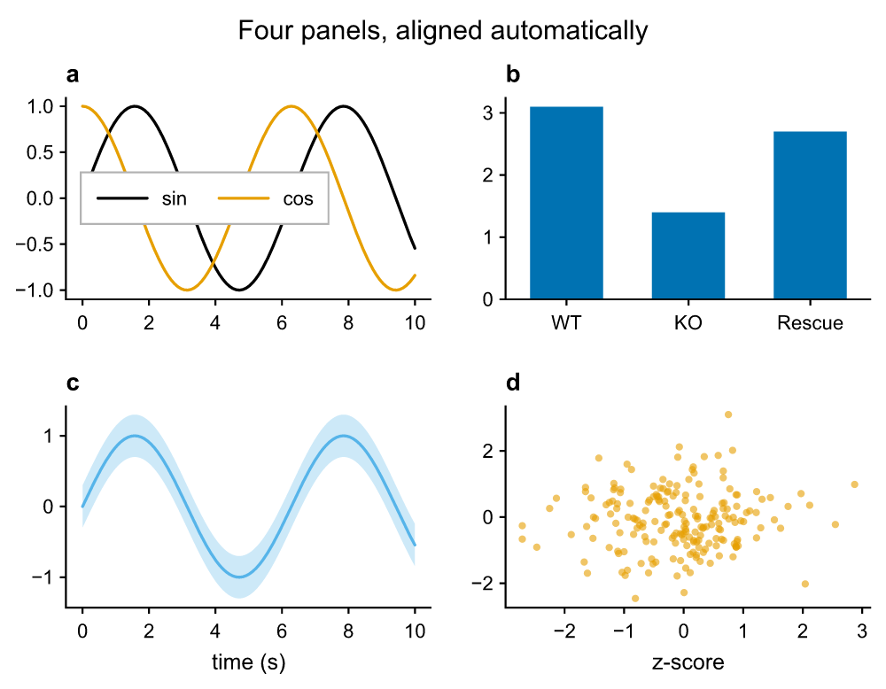

# pyplotrs

[](https://github.com/tkclam/pyplotrs/actions/workflows/CI.yml)
[](https://pypi.org/project/pyplotrs/)
[](https://tkclam.github.io/pyplotrs/)

Fast, publication-quality figures for Python, with a Rust rendering core.

<p align="center">
  
</p>

```python
import pyplotrs as pp

fig, ax = pp.subplots()
ax.line([0, 1, 2, 3], [0, 1, 4, 9], label="$y = x^2$")
ax.scatter([0, 1, 2, 3], [0, 1, 4, 9])
ax.set(title="Hello", xlabel="x", ylabel="y")
ax.legend()

fig.save("hello.pdf")  # vector, with selectable, editable text
fig.save("hello.png")  # 200 dpi by default
```

- **Real text everywhere.** PDF and SVG keep labels as embedded-font text you
  can select and edit in Illustrator or Inkscape.
- **Good defaults.** Colorblind-safe palette, type sized for a journal column,
  and plots that align across a grid automatically.
- **Fast.** Data loops and rendering run in Rust with the GIL released; a
  million-point line saves in tens of milliseconds.
- **No hidden state.** Figures are objects you hold. Themes set every default
  in one place.
- **TeX math** in any label, typeset from the math font's OpenType MATH table.

Plot types cover lines, scatter, bars, histograms, box and violin plots,
images, meshes, contours, vector fields, spike rasters, polar and 3D axes, and
animations. See the [guide](https://tkclam.github.io/pyplotrs/guide/) and the
[gallery](https://tkclam.github.io/pyplotrs/gallery/).

## Install

```bash
pip install pyplotrs
```

Python 3.11+ on Linux, macOS or Windows. No runtime dependencies; NumPy
arrays are read directly.

## Development

You need [uv](https://docs.astral.sh/uv/) and Rust 1.92+.

```bash
uv sync                      # build the extension, install dev tools
uv run pytest                # Python tests
cargo test -p pyplotrs-engine
uv run ruff check && uv run ruff format --check && uv run pyright
```

The code is in three parts:

| | |
|---|---|
| `crates/engine` | Rust: scene description, text and math layout, PDF/SVG/PNG renderers, numeric kernels |
| `crates/python` | Rust: the `pyplotrs._core` extension, a thin layer over the engine |
| `python/pyplotrs` | Python: figures, axes, artists, layout, styling |

See [CONTRIBUTING.md](CONTRIBUTING.md) for more.

## License

MIT. Bundled fonts and colormap data carry their own permissive licenses;
see [THIRD-PARTY-NOTICES.md](THIRD-PARTY-NOTICES.md).
