# Gallery

Each image is produced by the script of the same name in
[`examples/`](https://github.com/tkclam/pyplotrs/tree/main/examples).

## quickstart

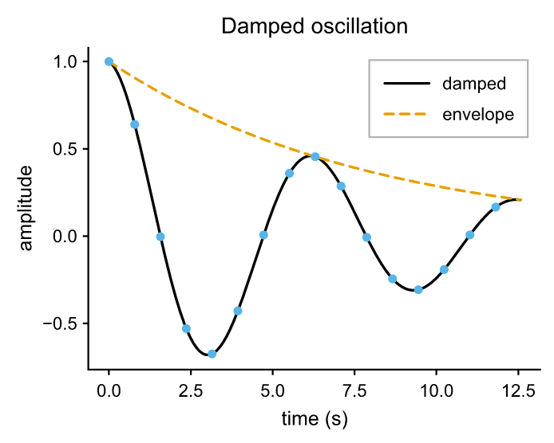

## subplots

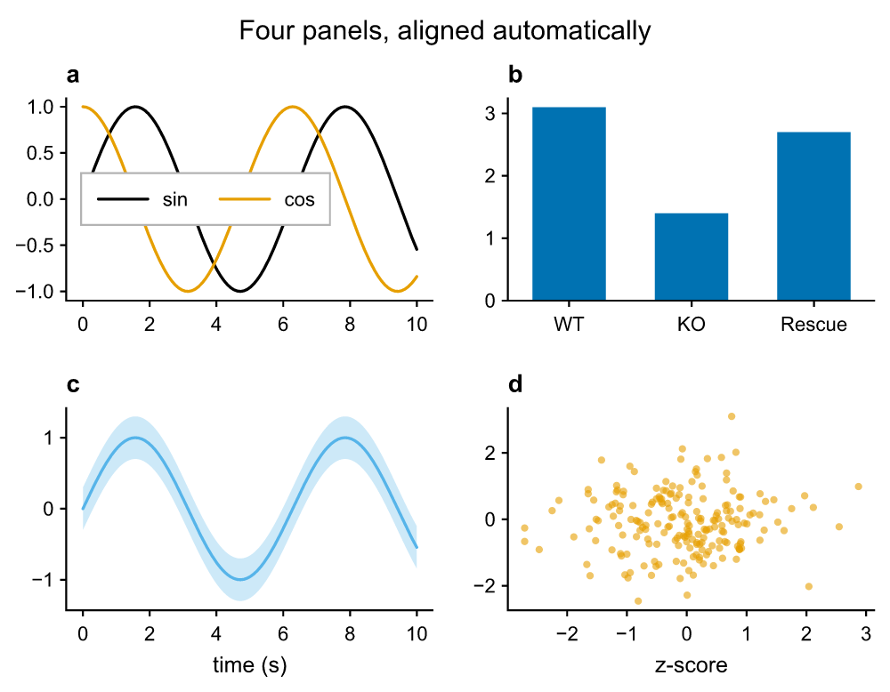

## statistics

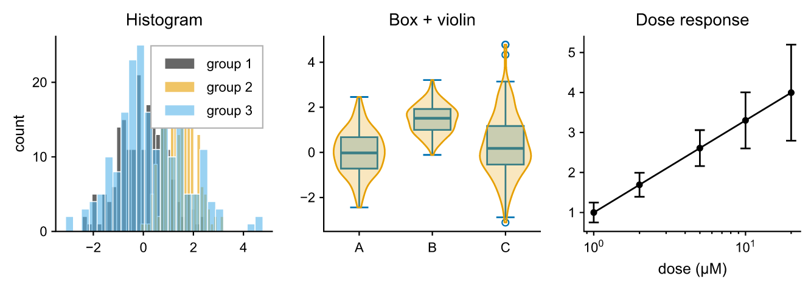

## images

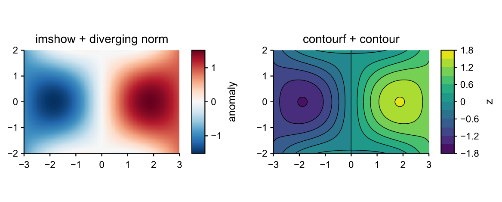

## neuroscience

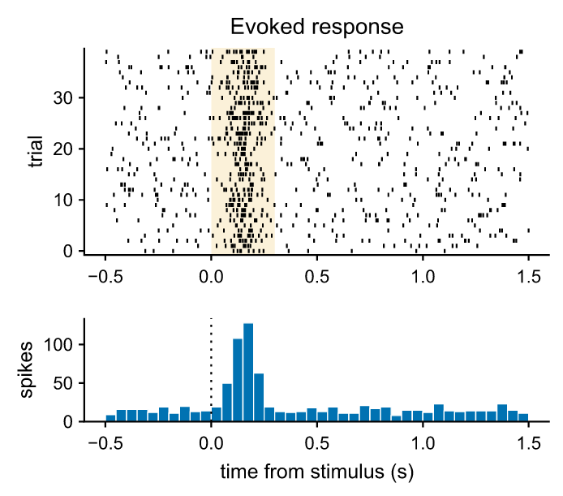

## scales

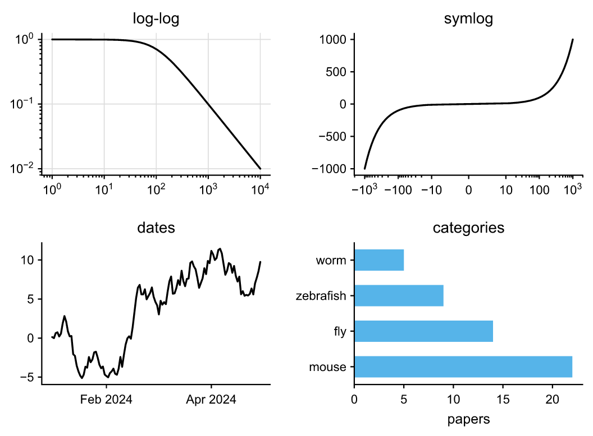

## annotations

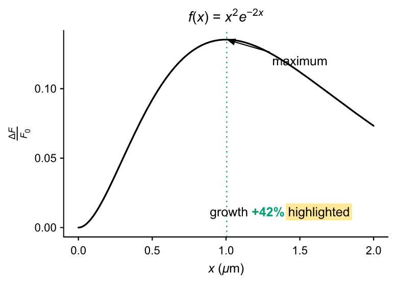

## layout

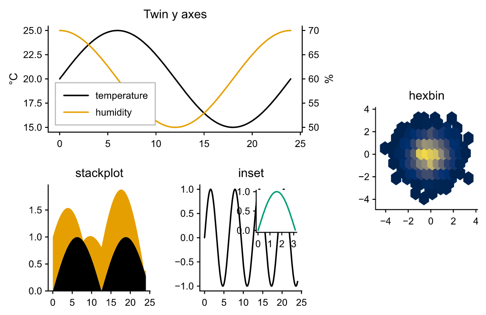

## polar

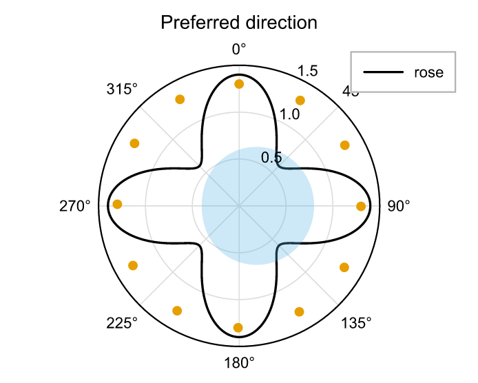

## surface3d

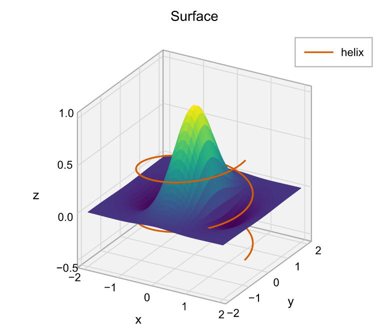

## theme_default

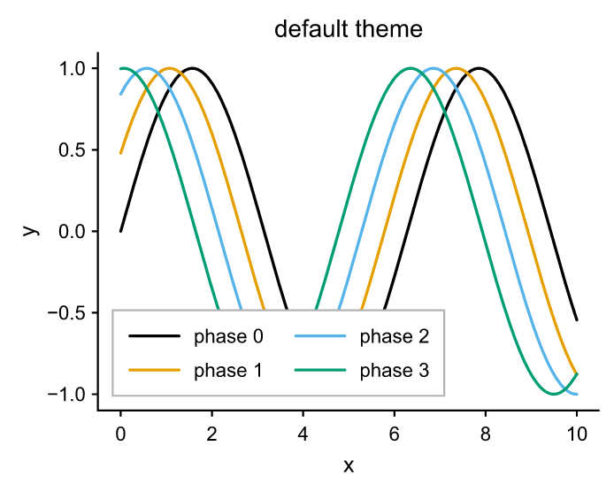

## theme_dark

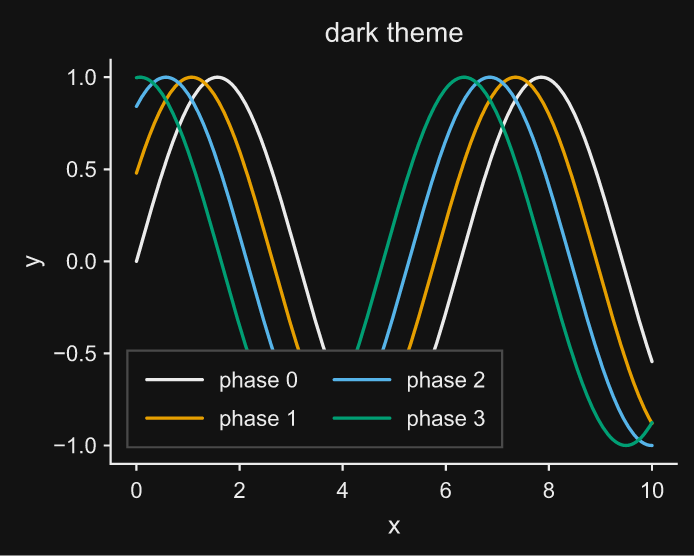

## theme_grayscale

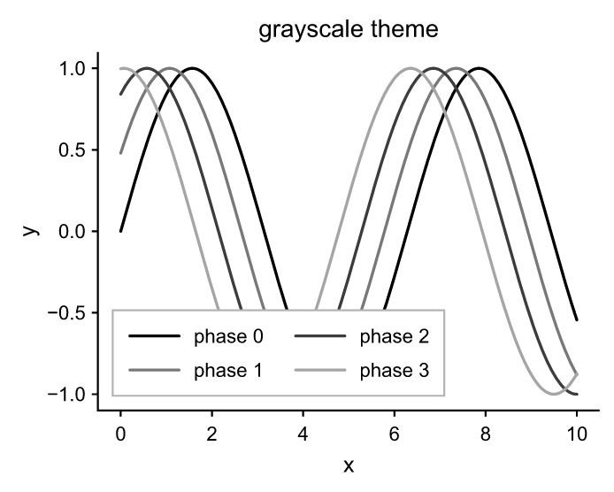

## theme_custom

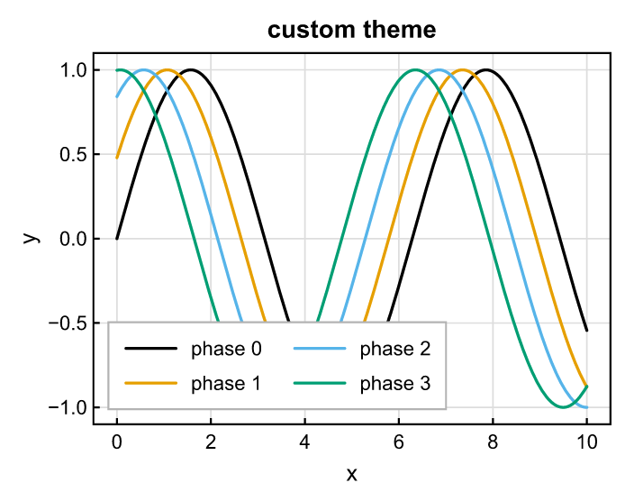

## animation

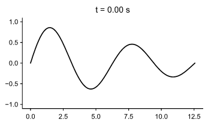
