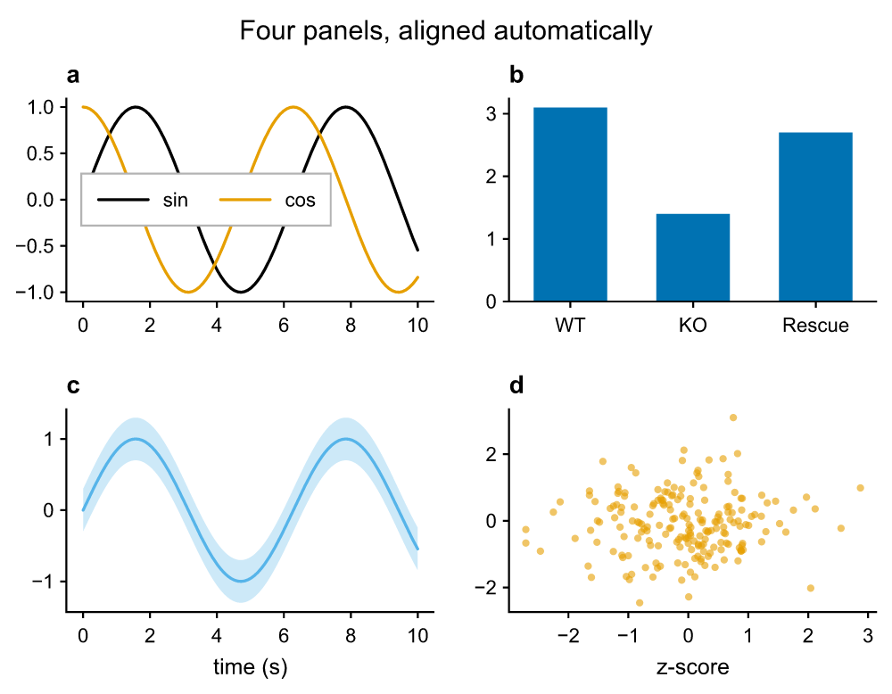

# pyplotrs

Fast, publication-quality figures for Python, with a Rust rendering core.



```python
import pyplotrs as pp

fig, ax = pp.subplots()
ax.line([0, 1, 2, 3], [0, 1, 4, 9], label="$y = x^2$")
ax.set(title="Hello", xlabel="x", ylabel="y")
ax.legend()
fig.save("hello.pdf")
```

## Why pyplotrs

- **Real text in every format.** PDF and SVG output embeds the fonts and keeps
  labels as selectable, editable text, so a figure can be retouched in
  Illustrator or Inkscape.
- **Good defaults.** A colorblind-safe palette, compact type sized for a journal
  column, and plots that align across a grid without manual spacing.
- **Fast.** Point loops, binning, contouring and rendering all run in Rust,
  with the GIL released. A million-point line saves in tens of milliseconds.
- **No hidden state.** Every figure is an object you hold; nothing depends on
  a "current" figure.
- **TeX math.** `$...$` in any label is typeset from the math font's OpenType
  MATH table.

## Install

```bash
pip install pyplotrs
```

Wheels are built for Linux, macOS and Windows on Python 3.11 and newer. There
are no runtime dependencies; NumPy arrays are read directly when given.

To build from source you need a Rust toolchain (1.92+) and
[uv](https://docs.astral.sh/uv/):

```bash
git clone https://github.com/tkclam/pyplotrs && cd pyplotrs
uv sync        # builds the extension and installs dev tools
uv run pytest
```

Next: the [guide](guide.md), the [gallery](gallery.md), or the
[API reference](api.md).
